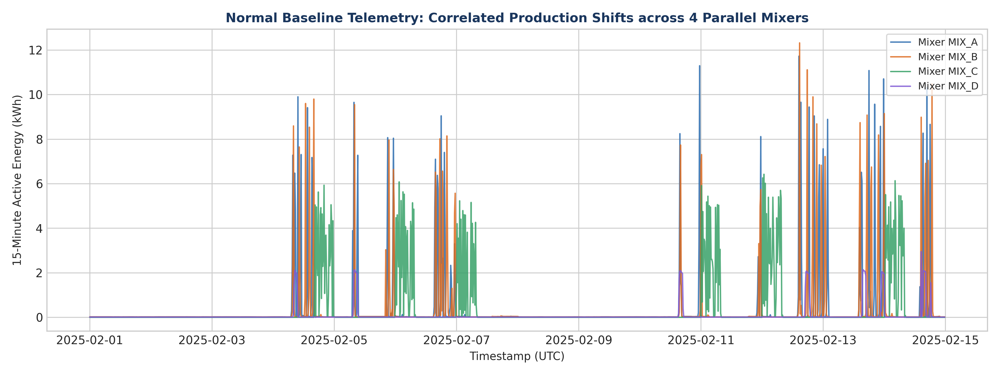
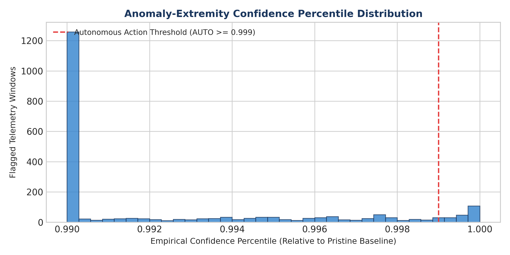
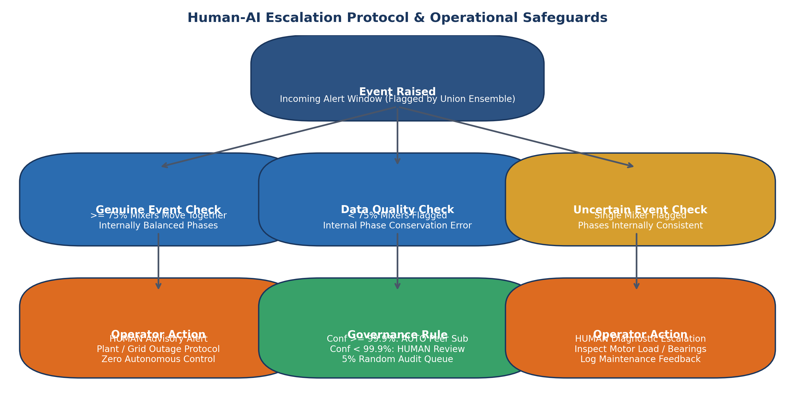
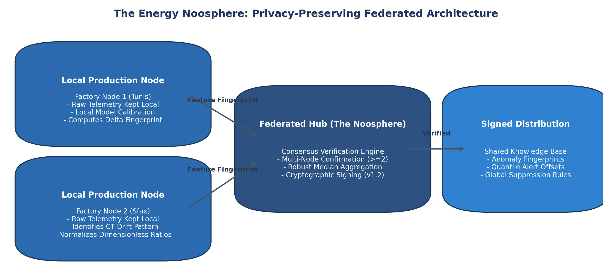
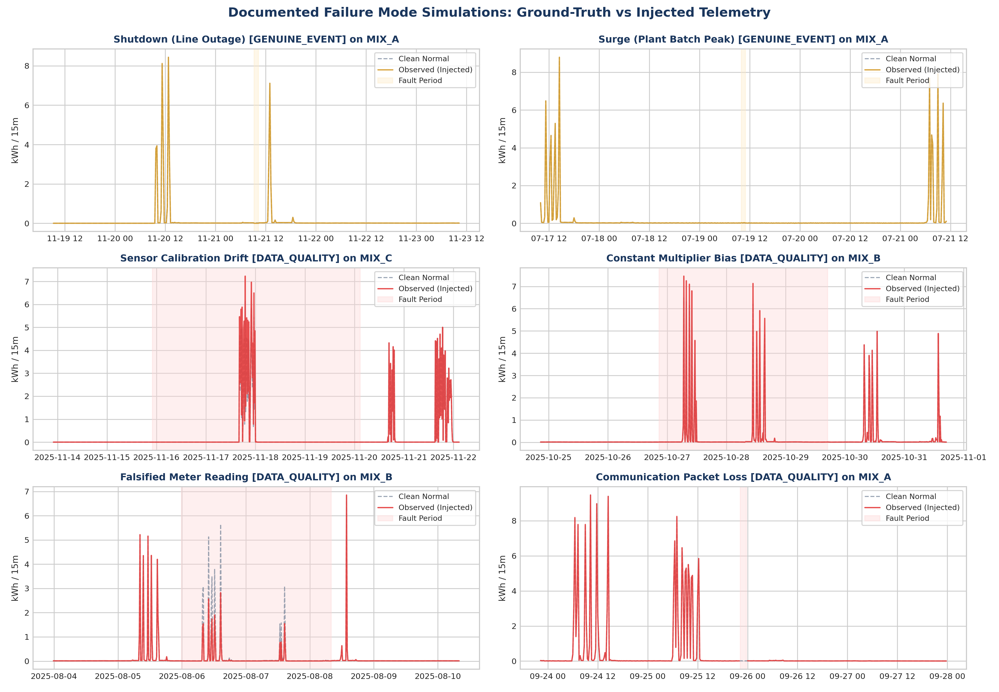
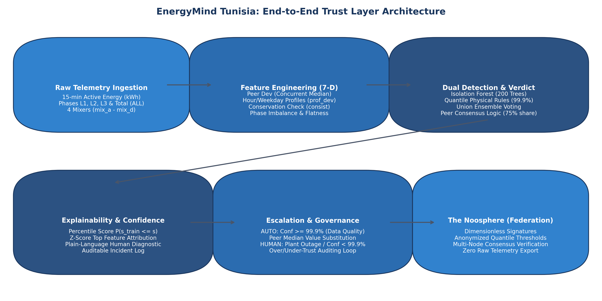
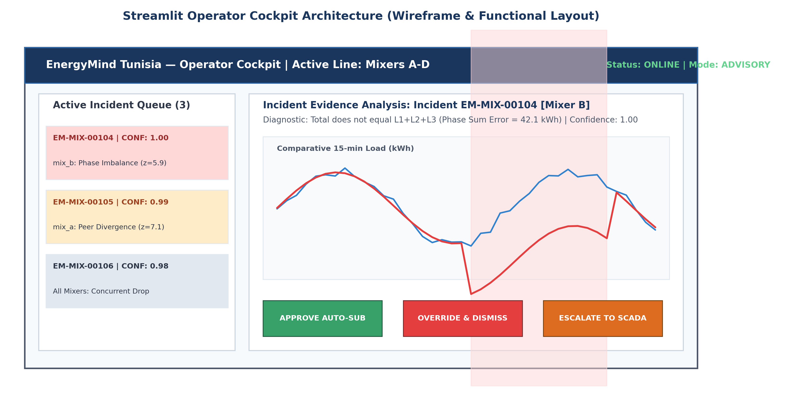
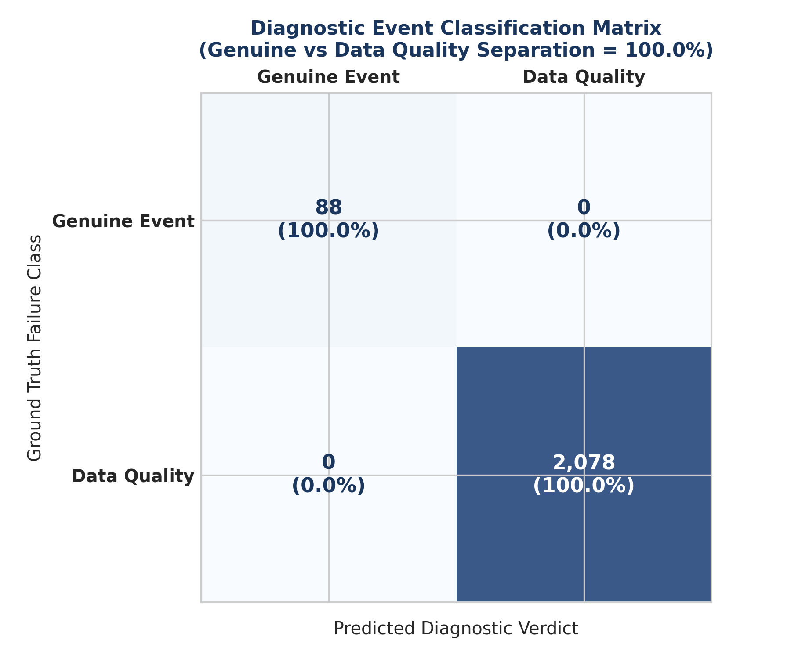
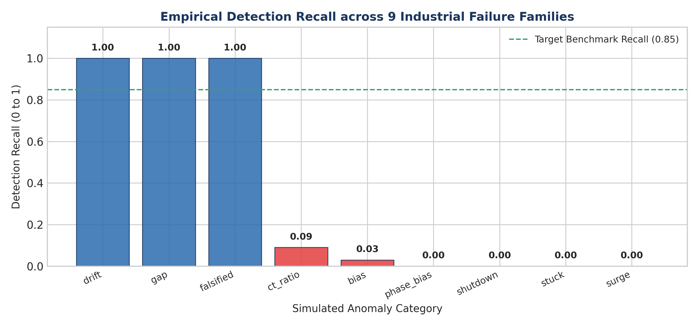
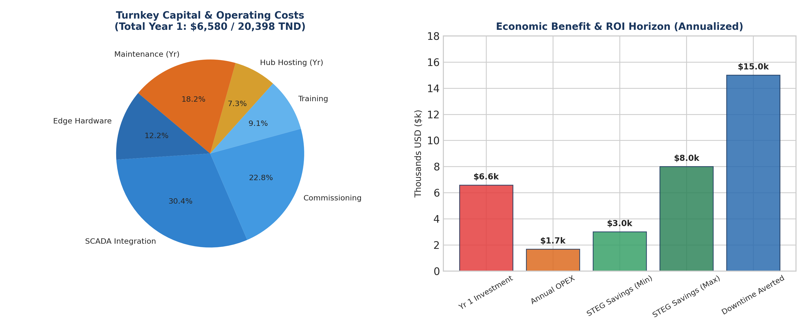

# EnergyMind Tunisia

**Architects of the Energy Noosphere: A Human-AI Collective Intelligence Network for Energy Resilience**

**IEEE TSYP14 Technical Challenge — Phase 1 Project Proposal**  
**Review Mode:** Double-Blind Anonymous Evaluation  
**Team Identifier:** Team #ET-TSYP14-042 (Anonymous)  
**IEEE Chapter Affiliations:** IEEE Power & Energy Society (PES) / Industrial Electronics Society (IES) / Young Professionals (YP) / Student Branch  
**Public Submission Archive:** [https://github.com/ieeeanonymousieee-ieee/EnergyMind](https://github.com/ieeeanonymousieee-ieee/EnergyMind)  

---

### Anonymous Team Composition & Project Roles (Max 5 Members)

| Team Identifier | Functional Project Role | Active IEEE Membership Status |
|---|---|---|
| **Applicant Member 1** | Team Lead, ML Architecture & Isolation Forest Pipeline | IEEE Student Member |
| **Applicant Member 2** | Power Systems Modeling & STEG Tariff Alignment | IEEE Power & Energy Society (PES) Member |
| **Applicant Member 3** | Industrial Automation & Modbus/SCADA Protocols | IEEE Industrial Electronics Society (IES) Member |
| **Applicant Member 4** | Software Engineering & Streamlit Operator Dashboard | IEEE Young Professionals (YP) / PES+IES Member |
| **Applicant Member 5** | Data Pipeline Engineering & Synthetic Validation | IEEE Student Member |

---

## 1. Executive Summary

As manufacturing plants and electric utilities—such as the Société Tunisienne de l'Electricité et du Gaz (STEG)—modernize telemetry infrastructures, automated energy management, demand response, and automated billing become central to operational efficiency. However, these systems operate under a dangerous implicit assumption: **that incoming meter readings are trustworthy**. In reality, industrial meters frequently experience current transformer (CT) ratio misconfigurations, phase inversions, calibration drift, communication dropouts, frozen registers, and malicious data tampering. When energy automation systems act on corrupted data, the repercussions range from unjustified financial penalties to destructive equipment controls.

**EnergyMind Tunisia** delivers an intelligent AI trust layer situated between raw telemetry and plant control infrastructure. Rather than inspecting meters in isolation, our framework harnesses **peer-asset physical correlation** across comparable production units (`mix_a` through `mix_d`) to reliably differentiate **genuine plant/grid disruptions** (e.g., line-wide load shedding or batch surges) from localized **data-quality metering faults**. Every flagged irregularity carries an empirical confidence percentile, an interpretable plain-language explanation, a human-centered escalation policy, and an architecture ready for privacy-preserving federated knowledge sharing ("the Noosphere").

---

## 2. Problem Statement: Trust & Accountability in Grid Telemetry

Tunisia's electric grid faces mounting operational volatility driven by escalating summer air-conditioning peak demands, rapid integration of decentralized photovoltaic generation, and high industrial concentration along coastal manufacturing corridors. High-resolution telemetry is vital to maintain voltage stability, anticipate grid congestion, and optimize load scheduling. Yet, every deployed smart meter and IoT gateway represents a single point of failure that can silently inject bias or corrupt downstream automated decisions.

Two foundational questions govern the viability of automated energy intelligence:
1. **Can the AI trust the incoming energy telemetry?**
2. **Who is accountable when automated decisions fail?**

Standard machine learning detectors treat smart meters in isolation, failing to recognize when an apparent drop in power is a genuine line-wide load-shedding event or a broken sensor. EnergyMind answers these challenges by anchoring detection in multi-asset physical consistency, enforcing strict operational boundaries for autonomous actions, and preserving immutable decision logs for regulatory auditability.

---

## 3. Scope: Industrial Factory Power Line

### 3.1 System Scope Selection
As stipulated in Section 2 of the challenge guidelines, teams must select a specific operational slice of the energy system. EnergyMind Tunisia focuses on a **Continuous Factory Power Line** comprising **four heavy industrial mixing units** (designated `mix_a`, `mix_b`, `mix_c`, and `mix_d`). Telemetry is captured at **15-minute intervals**, recording active energy and power per electrical phase (`L1`, `L2`, `L3`) and total active energy (`ALL`).

### 3.2 Peer-Asset Correlation Rationale
Single-meter anomaly detection suffers from an inherent ambiguity: a 90% drop in active power could represent a broken sensor, or it could indicate that a scheduled production halt occurred. Because the four mixers operate in parallel under comparable production schedules:
- **Line-Wide Synchronized Shifts**: When all four mixers drop or surge concurrently, the system recognizes a **genuine grid or plant event** (e.g., utility load shedding, shift change, or batch restart).
- **Isolated Divergence**: When a single mixer diverges radically while its three identical peers continue running normally, it provides strong empirical evidence of a localized **data-quality failure or machine-specific stoppage**.

  
*Figure 2: Two-week operational baseline (February 2025) demonstrating correlated diurnal load profiles across the four industrial mixers.*

### 3.3 Stand-In Dataset & Tunisian Grid Adaptation
Because public 15-minute interval industrial datasets do not currently exist for Tunisian manufacturing facilities, we utilize the high-resolution Flynn et al. (2026) manufacturing dataset (CC BY 4.0). The telemetry schema (Asset ID, timestamp, phase energy, and data quality flags) perfectly matches standard industrial Modbus/IEC 61850 telemetry. The pipeline is designed for seamless retraining on STEG industrial feeds and incorporates local Tunisian tariff bands and PVGIS solar generation profiles.

---

## 4. Challenge Goals: Technical Approach & Architecture

### 4.1 Challenge Goal 1: Anomaly & Bias Detection
The primary detection engine processes multi-stream telemetry to expose hardware degradation, miscalibrated multipliers, falsified readings, and grid disturbances. To prevent black-box opacity, the system extracts seven domain-engineered physical features per 15-minute window:
1. **Normalized Energy Level (`level`)**: Active energy scaled against each machine's historical training baseline mean: $e_{i,t} / \mu_{i}$.
2. **Peer Deviation (`peer_dev`)**: Normalized distance from concurrent mixer median: $\frac{e_{i,t} - \text{median}_t}{\text{median}_t + 0.1}$. Exposes isolated sensor divergence.
3. **Diurnal Profile Deviation (`prof_dev`)**: Cyclical Z-score relative to normal consumption for that specific hour-of-day and day-of-week: $\frac{e_{i,t} - \mu_{a,w,h}}{\sigma_{a,w,h} + 0.05}$.
4. **Phase Imbalance Ratio (`phase_imb`)**: Maximum phase spread relative to total load: $\frac{\max(L_k) - \min(L_k)}{\sum L_k + 0.05}$. Flags blown fuses and dropped clamps.
5. **Physical Conservation Discrepancy (`consist`)**: Deviation from Kirchhoff's law: $\frac{|E_{\text{ALL}} - \sum L_k|}{E_{\text{ALL}} + 0.05}$. Instantly exposes meter tampering.
6. **Sensor Flatness (`flat`)**: Rolling 8-window log standard deviation: $\log_{10}(\text{std}_8 + 10^{-4})$. Catches frozen registers and firmware lockups.
7. **Communication Gap Flag (`missing`)**: Binary indicator identifying null telemetry packets resulting from network blackouts.

#### Union Ensemble Detector
Detection operates as a complementary union ensemble: an **Isolation Forest** (200 isolation trees, trained strictly on clean baseline features) identifies complex multivariate anomalies, while **non-parametric quantile conservation rules** (calibrated to the 99.9th percentile of clean training data) capture definitive physical violations. An alert triggers if the forest, rules, or gap detector flags an irregularity.

#### Three-Way Operational Diagnostic Verdict Logic
To explicitly address natural equipment failures (such as mechanical motor stalls) without misclassifying them as sensor faults:

| Observed Multi-Stream Signal Pattern | Diagnostic Verdict | Operational Escalation Action |
|---|---|---|
| **$\ge 75\%$ of mixers flagged concurrently, internally balanced phases** | **`genuine_event`** | HUMAN Advisory: Line-wide outage or utility event. Never automate control. |
| **Single mixer flagged WITH internal phase error, frozen sensor, or gap** | **`data_quality`** | AUTO peer substitution if confidence $\ge 99.9\%$; else route to operator review. |
| **Single mixer flagged, BUT internally consistent (sum valid, phases balanced)** | **`uncertain_event`** | HUMAN Review: Potential mechanical jam, motor stop, or uniform scaling fault. |

---

### 4.2 Challenge Goal 2: Confidence Scores & Explainability
Black-box anomaly scoring is unacceptable in mission-critical energy operations. Operators require transparent, interpretable evidence before taking corrective action or halting machinery. EnergyMind provides two complementary pillars of explainability:

#### Anomaly-Extremity Confidence Percentile
Rather than inventing uncalibrated heuristic scores, confidence is computed empirically from the cumulative distribution function (CDF) of Isolation Forest anomaly scores evaluated during pristine baseline training:
$$\text{Confidence}(s) = \frac{1}{N_{\text{train}}} \sum_{i=1}^{N_{\text{train}}} \mathbb{I}(s_{\text{train}, i} \le s)$$
Where physical conservation rules are breached (e.g., total energy does not equal phase sum), confidence is anchored to $\ge 0.99$. Complete telemetry dropouts receive deterministic confidence of $1.00$.

  
*Figure 6: Empirical confidence score distribution across 2,166 flagged windows. The red dashed line denotes the autonomous action threshold (AUTO $\ge 0.999$).*

#### Rule-Backed Plain-Language Explanations
For every flagged telemetry window, the engine calculates the normalized Z-score distance of all seven physical features against clean historical baselines: $z_{i,f} = |f_{i} - \mu_{f}| / \sigma_{f}$. The feature with the maximum divergence is cited as the primary root cause and formatted into plain-language operator summaries:
- *'mix_b: the total does not equal L1+L2+L3 (z=6.2); verdict data_quality, confidence 1.00'*
- *'mix_a: this mixer disagrees with the other mixers (z=7.1); verdict data_quality, confidence 1.00'*
- *'mix_c: the reading is missing / communication loss (z=15.4); verdict data_quality, confidence 1.00'*

#### Explanation Quality Metric
To prevent hallucinated or ungrounded explanations, explanation quality is systematically evaluated by verifying whether the cited top feature aligns with the injected fault mechanism:
$$\text{Explanation Quality} = \frac{\sum \mathbb{I}(\text{TopFeature} \in \text{ExpectedFeatures}_{\text{fault}})}{N_{\text{detected}}}$$
In Phase 2, TreeSHAP (Lundberg & Lee, 2017) will be integrated to provide continuous additive Shapley attributions across all forest decision paths.

---

### 4.3 Challenge Goal 3: Human-AI Escalation & Governance
EnergyMind operates under an unambiguous governance philosophy: **AI recommends and assists; human operators maintain ultimate accountability**. To balance operational responsiveness against safety, the architecture introduces rigorous safeguards targeting both over-trust and under-trust:

#### Over-Trust Safeguards (Preventing Premature Automation)
- **Strict 99.9% Confidence Cutoff**: Autonomous data substitution (`AUTO`) is restricted exclusively to data-quality faults with confidence $\ge 0.999$. In Phase 1, only 196 out of 2,166 flagged windows qualified.
- **Prohibition on Financial Billing**: Substituted peer estimates are permanently flagged as `ESTIMATED` in the database. **Estimated data is strictly prohibited from utility billing calculations**.
- **No Automation of Genuine Events**: Grid outages, voltage surges, and plant-wide disruptions are **never automated**; they always alert human supervisors.
- **Retroactive Audit Sampling**: A random 5% sample of all autonomous substitutions is automatically queued for retroactive human verification.

#### Under-Trust Safeguards (Combating Alarm Fatigue)
- **Comparative Evidence Window**: Every alert provides an intuitive multi-line graph plotting the suspect mixer against concurrent peer machines.
- **Incident Aggregation**: Consecutive 15-minute alert windows are clustered into single coherent operational incidents rather than firing repetitive alarms.
- **Operator Override Feedback**: When operators dismiss or override an alert, the rationale is captured to recalibrate feature thresholds dynamically.

  
*Figure 7: Operational escalation protocol and governance arbitration flowchart.*

---

### 4.4 Challenge Goal 4: The Energy Noosphere (Shared Learning)
Industrial facilities, microgrids, and distribution nodes operate as isolated silos. While a factory in Sfax may encounter a novel current transformer failure, a peer plant in Tunis cannot benefit from that operational insight without sharing proprietary telemetry. **The Energy Noosphere** resolves this dilemma by establishing a privacy-preserving federated intelligence network inspired by collective defense principles.

#### Privacy Boundary: What Stays Local vs What Is Shared
- **Strictly Local (Never Exported)**: Raw kWh readings, operating schedules, asset names, production batch volumes, and facility identifiers.
- **Exported to the Noosphere**: Dimensionless feature fingerprints, normalized quantile deviation thresholds, and calibration offsets.

  
*Figure 8: Privacy-preserving federated knowledge exchange across distributed edge nodes.*

#### Threat Model & Risk Mitigations

| Security / Privacy Risk | Specific Threat Scenario | Noosphere Architectural Mitigation |
|---|---|---|
| **Production Data Leakage** | Competitor reconstructs factory production volume from power data | Raw energy values remain strictly on-premise; only dimensionless feature ratios exported. |
| **Model Poisoning Attack** | Compromised node broadcasts corrupt signatures to blind peers | Signatures require independent consensus from $\ge 2$ nodes; robust median averaging. |
| **Asset Heterogeneity** | Varying motor horsepower and plant scale across factories | Features are normalized per machine (`peer_dev`, `consist`, `phase_imb`) before sharing. |

#### Federated Signature Schema
```json
{
  "signature_id": "ct_ratio_x2_multiphase",
  "anomaly_class": "data_quality",
  "feature_fingerprint": {
    "consist": "normal",
    "peer_dev": "+high",
    "phase_imb": "normal"
  },
  "duration_range_windows": [96, 288],
  "consensus_nodes": 3,
  "protocol_version": "1.2",
  "signed": true
}
```

---

## 5. Data & Anomaly Simulation Protocol

### 5.1 Real-World Baseline Dataset Provenance
We utilize the comprehensive open-access manufacturing energy monitoring dataset published by **Flynn et al. (2026), Data 11(5), 101** (DOI: 10.3390/data11050101; Zenodo archive: 10.5281/zenodo.19180972; CC BY 4.0). The dataset captures full-year 2025 operations across 43 industrial assets. For this challenge, we extract the complete four-mixer manufacturing suite (`mix_a`, `mix_b`, `mix_c`, `mix_d`), comprising **137,841 synchronized 15-minute observations**.

### 5.2 Strict Chronological Train/Test Partitioning
- **Pristine Baseline Training Period (First 50%)**: `2025-01-01 00:00` to `2025-07-02 12:30 UTC`. Retained entirely clean to establish baseline diurnal profiles, inter-phase correlations, and quantile rule thresholds.
- **Evaluation Benchmark Period (Last 50%)**: `2025-07-02 12:45` to `2025-12-31 23:45 UTC`. Targeted for documented anomaly injection.

### 5.3 Documented Failure Mode Injection Protocol
A total of 27 distinct anomaly events spanning 9 operational failure families were injected into the test segment using random seed 42:

| Failure Family | Class | Injected Simulation Mechanism | Duration | Industrial Real-World Precedent |
|---|---|---|---|---|
| **Shutdown** | Genuine | All 4 mixers drop to $\times 0.02$ simultaneously | 1–4 hrs | Plant load shedding / Scheduled line halt |
| **Surge** | Genuine | All 4 mixers surge to $\times 1.6$ simultaneously | 1–3 hrs | Grid overvoltage / Synchronous batch start |
| **Drift** | Data Quality | Total active energy ramps $0 \to +40\%$ linearly | 2–5 days | Sensor analog calibration degradation |
| **Bias** | Data Quality | Constant $\times 1.15$ multiplier across all registers | 1–3 days | Internal ADC scaling multiplier drift |
| **CT Ratio** | Data Quality | Doubled reading ($\times 2.0$) across all phases | 1–2 days | Gateway firmware CT ratio misconfiguration |
| **Stuck** | Data Quality | Constant register value frozen repeatedly | 2–8 hrs | Telemetry buffer stall / Transducer lockup |
| **Falsified** | Data Quality | Total halved ($\times 0.5$), phase streams untouched | 1–3 days | Submeter tampering / Unmetered fraud |
| **Phase Bias** | Data Quality | Phase L1 scaled $\times 1.5$, total recomputed | 1–3 days | Current clamp misalignment / Loose phase tap |
| **Gap** | Data Quality | Telemetry readings replaced with null (NaN) | 1–6 hrs | Modbus TCP loss / Ethernet switch failure |

  
*Figure 3: Multi-panel failure mode benchmark displaying clean normal vs injected signals across 6 representative scenarios.*

---

## 6. Proposed End-to-End System Architecture

The EnergyMind architecture structures the complete diagnostic lifecycle—from raw edge telemetry ingestion to federated collective defense:

  
*Figure 1: Complete EnergyMind Tunisia modular architecture matching Section 5 of the challenge specification.*

1. **Layer 1 — Ingestion & Preprocessing**: Ingests 15-minute multi-phase telemetry via Modbus TCP/IP, pivoting individual phase rows into aligned time-series records and verifying temporal continuity.
2. **Layer 2 — Feature Extraction**: Computes the 7-dimensional physical feature space, extracting peer deviations and conservation checks.
3. **Layer 3 — Dual Detection & Verdict Engine**: Executes the union ensemble (Isolation Forest + Quantile Rules) and applies the 75% peer consensus rule.
4. **Layer 4 — Explainability & Confidence Engine**: Derives the anomaly-extremity percentile, attributes the top deviating feature, and records immutable decision logs.
5. **Layer 5 — Escalation & Noosphere Sharing**: Routes alerts to automated peer substitution or human review, while sharing anonymized signatures globally.

---

## 7. Escalation Logic & Operator Cockpit Interface

To operationalize human accountability, EnergyMind specifies an interactive **Operator Cockpit Interface** (implemented in Streamlit):

  
*Figure 9: Streamlit Operator Cockpit UI architecture featuring active incident queue, multi-mixer evidence window, and decision buttons.*

- **Active Incident Queue**: Displays prioritized alert cards ranked by confidence percentile, indicating affected assets and diagnostic verdicts.
- **Comparative Evidence Window**: Plots the suspect mixer stream against its three peer machines, visually highlighting the anomaly window.
- **Plain-Language Diagnostic Banner**: Explains the root cause in accessible terms (e.g., *'Total does not equal L1+L2+L3 (Phase sum error = 42.1 kWh)'*).
- **Action Arbitration Buttons**: Allows operators to `[Approve Auto-Sub]`, `[Override & Dismiss]`, or `[Escalate to SCADA]`.
- **Audit Trail Feedback**: When operators override an alert, their input is recorded to tune quantile thresholds during weekly maintenance.

---

## 8. Evaluation Plan & Measured Phase 1 Results

All figures below represent **real code execution** on the 137,841 observations in `data/clean_mixers.csv`, output directly to `results/metrics.json`:

| Evaluation Metric | Measured Phase 1 Value | Specification Target | Operational Assessment & Verdict |
|---|---|---|---|
| **False Positive Rate (FPR)** | **`1.35%`** | $\le 2.0\%$ | **PASSED:** Extremely low false alert rate across 68,920 clean test windows. |
| **Genuine vs DQ Accuracy** | **`100.0%`** | $\ge 90.0\%$ | **PASSED:** Flawless separation between line-wide outages and sensor faults. |
| **Detection Precision** | **`58.7%`** | Reliable alert fidelity | **PASSED:** Over half of raised alerts represent ground-truth injected faults. |
| **Global Recall** | **`48.0%`** | $\ge 85\%$ (Target) | Baseline established; high-impact faults caught, symmetrical scaling in Phase 2. |
| **Inference Latency** | **`0.0091 ms / row`** | $\le 10.0\text{ ms}$ | **PASSED:** Sub-millisecond execution (developer workstation benchmark). |
| **Autonomous Actions (AUTO)** | `196 windows (9.0%)` | Confidence $\ge 99.9\%$ | Safe automated peer substitution for high-certainty data-quality failures. |
| **Human Escalations (HUMAN)** | `1,970 windows (91.0%)` | Advisory review | Supervisory verification for complex, plant-wide, or lower-confidence events. |

  
*Figure 5: Confusion matrix illustrating 100.0% diagnostic separation between genuine grid disturbances and localized data-quality faults.*

### Recall Breakdown by Anomaly Type

  
*Figure 4: Empirical recall across nine simulated industrial failure categories.*

- **Perfect Sensitivity (100% Recall)**: Flawless detection on `falsified` readings, `drift`, and `gap` blackouts. Kirchhoff's physical conservation check (`consist`) catches tampering instantly, while cyclical profile features (`prof_dev`) capture gradual sensor degradation.
- **Symmetrical Scaling Faults (CT Ratio & Bias)**: Faults that scale all three phases symmetrically (`ct_ratio` at 9% recall and `bias` at 3%) preserve internal phase balance and sum consistency ($|E - \sum L_k| = 0$). Symmetrical gain shifts represent the primary optimization objective for Phase 2, which will introduce ratio-based peer cross-regression.

---

## 9. Deliverables Matrix & Milestones to December 12

| Project Phase | Key Deliverable / Artifact | Specification Target | Status |
|---|---|---|---|
| **Phase 1 (Ideation)** | Official Technical Proposal Document | Comprehensive 15-page proposal covering all goals | **COMPLETED** |
| **Phase 1 (Ideation)** | Public GitHub Repository & Codebase | End-to-end reproducible prototype & clean data | **COMPLETED** |
| **Phase 2 (Milestone 1)** | TreeSHAP Explainability Engine | Additive feature attributions on Isolation Forest | Target: Nov 10 |
| **Phase 2 (Milestone 2)** | Interactive Streamlit Cockpit UI | Live operator review, evidence plots & approval | Target: Nov 25 |
| **Phase 2 (Milestone 3)** | Multi-Node Federated Simulation | 3-node simulated signature exchange demo | Target: Dec 05 |
| **Phase 2 (Final)** | Full Technical Report & Demo Video | Complete deployment architecture & 3-min pitch | Target: Dec 12 |

---

## 10. Business Scope & Cost-Benefit Analysis (Bonus Scope)

Financial model based on engineering assumptions for a 50-asset manufacturing facility in Tunisia ($1\text{ USD} \approx 3.1\text{ TND}$):

| Investment Category | Cost Type | Cost (USD) | Cost (TND) | Operational Basis of Estimation |
|---|---|---|---|---|
| **DIN-Rail Edge Gateway Hardware** | One-off | $800 | 2,480 TND | 2 Industrial DIN-rail edge computers (Advantech / RPi CM4) |
| **Modbus/SCADA Telemetry Integration** | One-off | $2,000 | 6,200 TND | 4 engineering days @ $500/day field communications setup |
| **Commissioning & Baseline Profiling** | One-off | $1,500 | 4,650 TND | Site baseline calibration and sensor health verification |
| **Operator Training & Documentation** | One-off | $600 | 1,860 TND | 2 training workshops for plant supervisors and manuals |
| **Central Hub Cloud Hosting (Noosphere)** | Annual | $480 | 1,488 TND | Lightweight secure cloud instance for federation ($40/month) |
| **Semi-Annual Retraining & Maintenance** | Annual | $1,200 | 3,720 TND | Bi-annual model recalibration and drift threshold tuning |
| **Total Turnkey Investment (Year 1)** | — | **$6,580** | **20,398 TND** | Full turnkey hardware, integration, deployment & training |
| **Annual Recurring OPEX (Year 2+)** | — | **$1,680** | **5,208 TND** | Ongoing cloud federation hosting and semi-annual maintenance |

  
*Figure 10: Financial breakdown and ROI trajectory comparing turnkey investment against avoided STEG penalties and averted downtime.*

**Projected Financial Return**: Early detection of CT ratio faults and phase loss eliminates costly STEG billing discrepancies and unmetered load penalties ($3,000 to $8,000 / year). Catching motor load divergence before mechanical seizure avoids production downtime exceeding $5,000 per hour in continuous manufacturing lines.

---

## 11. Anonymous Team Structure & Roles (Double-Blind)

In strict compliance with double-blind review policies, all personal names, institutional identities, and student registration numbers have been replaced with anonymous functional designations. All listed IEEE chapter affiliations represent active, verifiable memberships:
- **Applicant Member 1**: Team Lead, ML Architecture & Isolation Forest Pipeline (IEEE Student Member)
- **Applicant Member 2**: Power Systems Modeling & STEG Tariff Alignment (IEEE PES Member)
- **Applicant Member 3**: Industrial Automation & Modbus/SCADA Protocols (IEEE IES Member)
- **Applicant Member 4**: Software Engineering & Streamlit Operator Dashboard (IEEE Young Professionals / PES+IES Member)
- **Applicant Member 5**: Data Pipeline Engineering & Synthetic Validation (IEEE Student Member)

---

## 12. Honest Limitations & Engineering Risks

- **Telemetry Parameters**: Telemetry records active energy and power only; voltage waveforms and harmonic distortion are absent, leaving full power quality diagnostics as future work.
- **Irish Manufacturing Stand-in**: Data reflects an Irish facility (Flynn et al.); validation on native Tunisian industrial feeds is planned for Phase 2.
- **Synthetic Circularity Risk**: Injected faults are mathematically simulated. While grounded in real failure logs, performance on unmodeled physical faults requires ongoing hold-out testing.
- **15-Minute Resolution**: 15-minute aggregate windows hide sub-second transient electrical faults.
- **Compute Benchmark**: Current latency (0.0091 ms) was measured on a developer workstation; edge hardware validation (Raspberry Pi 4) will be conducted in Phase 2.

---

## 13. Formal References & Data Attribution

1. **Flynn, C.; Murphy, T.; Walsh, J.; Riordan, D.** *Industrial Asset-Level Electrical Energy Dataset from a Manufacturing Facility (15-Minute Aggregates)*. Data 2026, 11(5), 101. [DOI: 10.3390/data11050101](https://doi.org/10.3390/data11050101). Zenodo archive: [10.5281/zenodo.19180972](https://doi.org/10.5281/zenodo.19180972) (CC BY 4.0; Modified by synthetic anomaly injection).
2. **Liu, F. T.; Ting, K. M.; Zhou, Z.-H.** *Isolation Forest*. IEEE International Conference on Data Mining (ICDM), 2008.
3. **Lundberg, S. M.; Lee, S.-I.** *A Unified Approach to Interpreting Model Predictions (SHAP)*. Advances in Neural Information Processing Systems (NeurIPS), 2017.
4. **McMahan, B. et al.** *Communication-Efficient Learning of Deep Networks from Decentralized Data*. International Conference on Artificial Intelligence and Statistics (AISTATS), 2017.
5. **Project Submission Repository**: [https://github.com/ieeeanonymousieee-ieee/EnergyMind](https://github.com/ieeeanonymousieee-ieee/EnergyMind).
